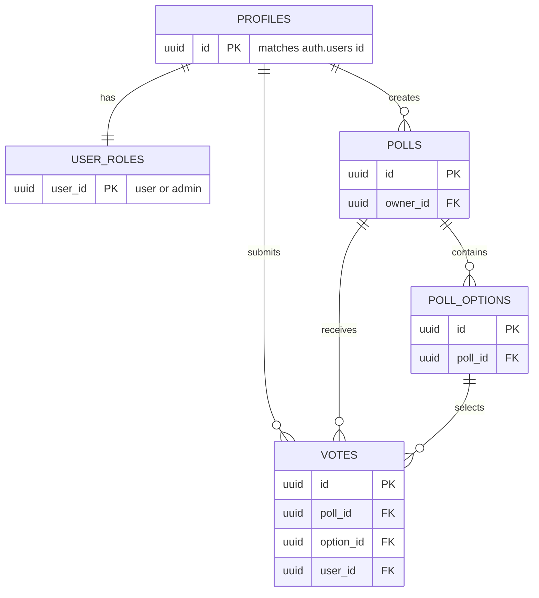

# PollPulse

PollPulse is a responsive multi-page poll application for creating questions, voting once per poll, managing personal profiles, and moderating public content.

## Features

- Email/password authentication through Supabase Auth
- Seven distinct pages: explore, login, registration, poll detail/voting, create poll, profile, and admin moderation
- Role-aware admin moderation and RLS-enforced access control
- Five related tables: profiles, user_roles, polls, poll_options, and votes
- Avatar upload to Supabase Storage
- Responsive Bootstrap UI and vanilla JavaScript modules

## Architecture

The browser runs separate HTML screens with shared JavaScript modules. `src/js/supabase.js` is the only module that creates a Supabase client. PostgreSQL and storage policies enforce authorization independently of the UI. The migration in `supabase/migrations/` creates the schema, indexes, triggers, and RLS policies.

```
Browser pages → JavaScript modules → Supabase REST API
                                  ├─ Auth
                                  ├─ PostgreSQL tables + RLS
                                  └─ Storage bucket: avatars
```

## Database schema



## Local setup

1. Create a Supabase project.
2. Run `supabase/migrations/20261106110000_pollpulse_schema.sql` in its SQL Editor, or use `supabase db push`.
3. Copy `.env.example` to `.env` and add the project URL and publishable anon key.
4. Install dependencies with `pnpm install` and start the app with `pnpm dev`.
5. To make yourself an administrator after registering, run `update public.user_roles set role = 'admin' where user_id = '<your-user-id>';` in the SQL Editor.

## Build and deployment

Run `pnpm build`; deploy the generated `dist/` folder to Netlify, Vercel, or another static host. Set the two `VITE_SUPABASE_*` variables in the host's build environment. Never expose a Supabase service-role key in the browser.

## Assessment delivery checklist

- [ ] A real Supabase project has the migration applied and the avatar bucket created.
- [ ] Registration, login, voting, profile upload, and admin moderation have been tested in the deployed app.
- [ ] A demo account and password are included for assessors.
- [ ] The public repository contains at least 15 meaningful commits across three different days.
- [ ] The deployment has been rebuilt with `VITE_SUPABASE_URL` and `VITE_SUPABASE_ANON_KEY` available at build time.
- [ ] Screenshots of the responsive UI and the deployed URL are included in the project documentation.

## Key folders

- `src/` — multi-page UI, shared styles, and JavaScript modules
- `supabase/migrations/` — versioned schema and RLS configuration
- `.github/copilot-instructions.md` — project-wide AI agent guidance
