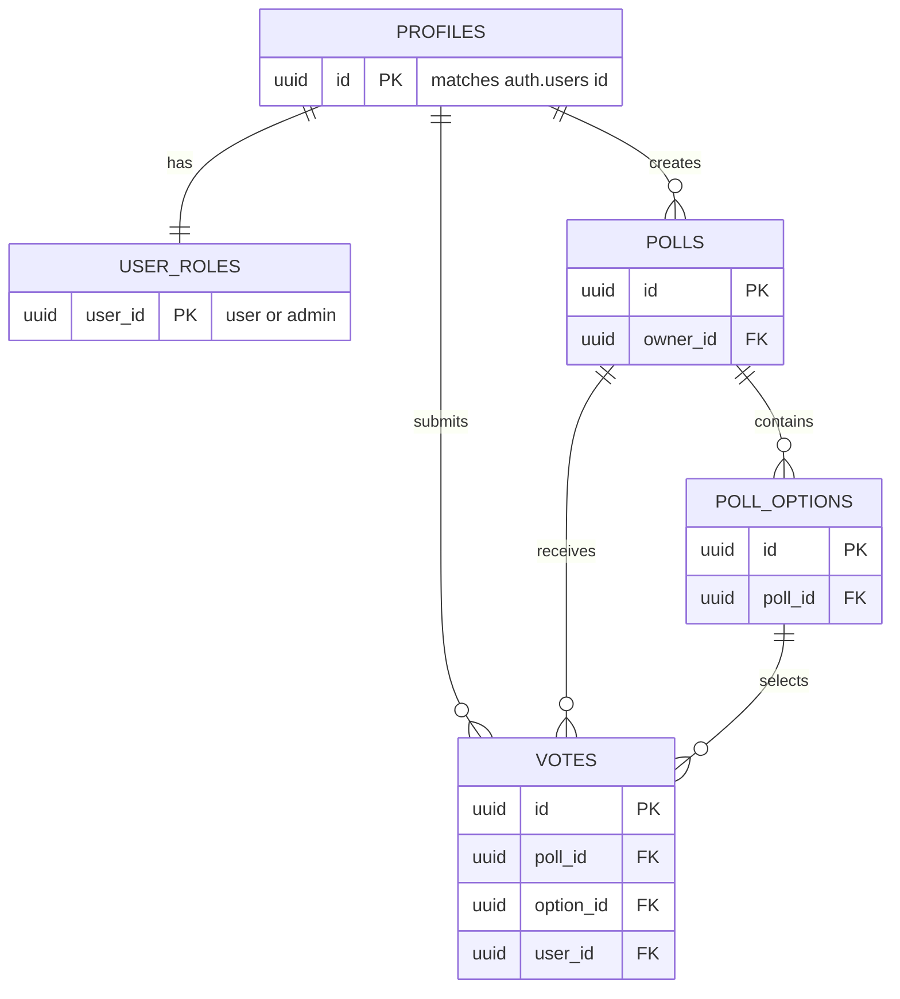

# PollPulse

PollPulse is a responsive multi-page poll application for creating questions, voting once per poll, managing personal profiles, and moderating public content.

## Features

- Email/password authentication through Supabase Auth
- Seven distinct pages: explore, login, registration, poll detail/voting, create poll, profile, and admin moderation
- Role-aware admin moderation and RLS-enforced access control
- Five related tables: profiles, user_roles, polls, poll_options, and votes
- Avatar upload to Supabase Storage
- Responsive Bootstrap UI and vanilla JavaScript modules
- Live-session templates, outline import, presenter mode, QR phone joining, anonymous responses, reactions, moderated Q&A, quiz leaderboard, and CSV session reports

## Architecture

The browser runs separate HTML screens with shared JavaScript modules. `src/js/supabase.js` is the only module that creates a Supabase client. PostgreSQL and storage policies enforce authorization independently of the UI. The migration in `supabase/migrations/` creates the schema, indexes, triggers, and RLS policies.

```
Browser pages → JavaScript modules → Supabase REST API
                                  ├─ Auth
                                  ├─ PostgreSQL tables + RLS
                                  └─ Storage bucket: avatars
```

## Database schema



## Local setup

1. Create a Supabase project.
2. Run both migrations in order: `supabase/migrations/20261106110000_pollpulse_schema.sql` and `supabase/migrations/20261110090000_live_sessions.sql`.
3. Copy `.env.example` to `.env` and add the project URL and publishable anon key.
4. Install dependencies with `pnpm install` and start the app with `pnpm dev`.
5. To make yourself an administrator after registering, run `update public.user_roles set role = 'admin' where user_id = '<your-user-id>';` in the SQL Editor.

## Build and deployment

Run `pnpm build`; deploy the generated `dist/` folder to Netlify, Vercel, or another static host. Set the two `VITE_SUPABASE_*` variables in the host's build environment. Never expose a Supabase service-role key in the browser.

## Assessment delivery checklist

- [x] A real Supabase project has both migrations applied and the avatar bucket configured.
- [ ] Registration, login, voting, profile upload, and admin moderation have been retested on the final deployment.
- [ ] A demo account and password have been created for assessors.
- [x] The public repository contains at least 15 meaningful commits across three different days.
- [x] The deployment has been rebuilt with `VITE_SUPABASE_URL` and `VITE_SUPABASE_ANON_KEY` available at build time.
- [ ] Screenshots of the responsive UI and deployed URL have been attached to the final submission.

## Demo walkthrough

1. Register or log in, then create a standard poll with at least two choices.
2. Open the poll, vote, and show the host's animated live-result bars.
3. Select **Live session** from the homepage. Choose **Quick quiz**, or paste an outline such as `Which idea first? | Idea A | Idea B`.
4. Publish the session, then use presenter mode to advance the slides.
5. Scan the QR code with a second device. The audience can join in the browser without an account, answer, react with emoji, and ask a question.
6. Back in presenter mode, approve a question and show the quiz leaderboard.
7. Open **Session report** and download its CSV export.

## Assessor access

- Deployed app: `https://pollpulse-capstone-2026.rado-ccs.chatgpt.site`
- Source repository: `https://github.com/radoslavge-art/pollpulse-capstone`
- Before submission, add the agreed demo-account credentials here or in the submission form. Do not commit real personal credentials.

## Key folders

- `src/` — multi-page UI, shared styles, and JavaScript modules
- `supabase/migrations/` — versioned schema and RLS configuration
- `.github/copilot-instructions.md` — project-wide AI agent guidance
